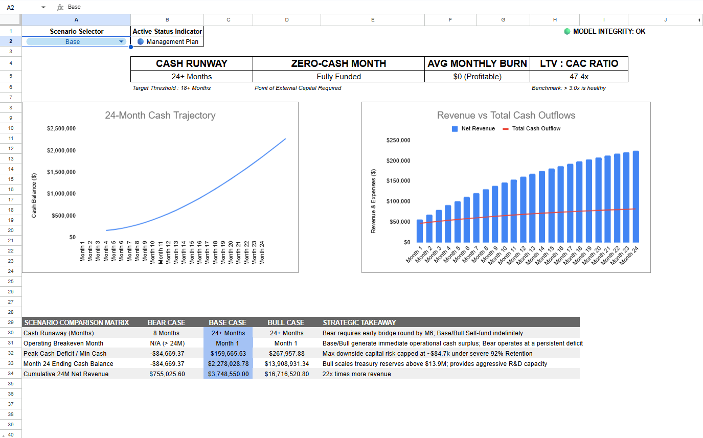

# Dynamic 24-Month SaaS Unit Economics & Cash Runway Model

An institutional-grade 24-month dynamic financial model built to forecast liquidity, model subscriber cohort churn, and stress-test capital runway under severe downside operational conditions.

🔗 **[Click Here to View the Live Google Sheets Model](https://docs.google.com/spreadsheets/d/1_Qe0FWkJqMzlXXm83gcp5BsiLp_Q-Tk4kARkq38llec/edit?usp=sharing)** *(View-only: Select File > Make a Copy to test drivers)*

---

## Executive Summary & Scenario Analysis

The model evaluates a recurring-revenue subscription business transitioning through initial operating scale. Rather than relying on static, optimistic revenue curves, the model runs a real-time scenario engine across three operational states:

| Metric | Bear Case (Stress Test) | Base Case (Management Plan) | Bull Case (Expansion) |
|---|:---:|:---:|:---:|
| **Cash Runway** | **8 Months** | **24+ Months** | **24+ Months** |
| **Operating Breakeven** | **N/A (> 24M)** | **Month 1** | **Month 1** |
| **Peak Cash Deficit** | **-$84,669** | **$159,667** | **$267,958** |
| **Month 24 Ending Cash** | **-$84,669** | **$2,278,029** | **$13,908,931** |
| **24M Cumulative Net Revenue** | **$755,026** | **$3,748,550** | **$16,716,521** |
| **LTV : CAC Multiple** | **8.9x** | **47.4x** | **110.0x** |

---

## Strategic Takeaways & Stress-Test Findings

1. **The Structural Deficit in the Bear Case:**
   * Under downside assumptions ($8.0\%$ monthly churn against $90$ new customer additions/month), subscriber scale hits an asymptotic ceiling of $1,125$ active users:
     $$\text{Customer Ceiling} = \frac{\text{New Additions}}{\text{Monthly Churn \%}} = \frac{90}{0.08} = 1,125 \text{ users}$$
   * At $1,125$ users, maximum monthly gross profit caps at **~$26.3k**, failing to cover the **$27.7k** fixed monthly operating overhead (OPEX).
   * **Strategic Implication:** The business cannot "grow out" of its burn. Cash runs out in **Month 9**, requiring either a minimum **$84.7k** capital injection or structural overhead downsizing by Month 6.

2. **Unit Economics Discipline:**
   * Customer Lifetime Value ($LTV$) is calculated strictly using **Contribution Gross Margin** rather than vanity top-line revenue, accounting for payment processor cuts ($2.95\%$), cloud hosting ($3.00$/user), and customer support costs ($6.00$/user):
     $$LTV = \frac{\text{ARPU} \times \text{Gross Margin \%}}{\text{Monthly Churn Rate}}$$
   * Base Case generates an $LTV : CAC$ ratio of **$47.4x$**, indicating healthy unit economics and strong capacity to deploy incremental marketing spend.

---

## Model Architecture

The workbook is designed under institutional financial modeling standards across three decoupled sheets:
- **`01_Dashboard`:** Executive KPI scorecards (Runway, Zero-Cash Month, Net Burn, LTV:CAC), 24-month cash curve visualization, and breakeven combo charts.
- **`02_Forecast_24M`:** Calculation engine applying mid-month customer averaging, cohort churn applied strictly to beginning user balances, and operational cash-flow rollover.
- **`03_Assumptions`:** Modular driver repository segregating customer acquisition volume, monetization tiers, variable COGS, and fixed operating expenses.

---

## Audit-Proof Integrity System

To prevent silent calculation breaks, row 38–40 on the calculation engine runs automated reconciliations across all 24 periods:
- **Cash Continuity Check:** Validates that Month $N$ Beginning Cash exactly reconciles with Month $N-1$ Ending Cash ($\Delta = \$0.00$).
- **Customer Conservation Check:** Enforces that Beginning Active + New Acquired - Churned reconciles to Ending Active Users ($\Delta = 0$).
- If any cell across the 24 months violates continuous balance, the dashboard immediately alerts: `🔴 AUDIT FAILURE`.

---

## File Contents
- `SaaS_24M_Runway_Model.xlsx`: Master financial model spreadsheet file.
- `images/`: High-resolution dashboard previews and scenario stress-test charts.
